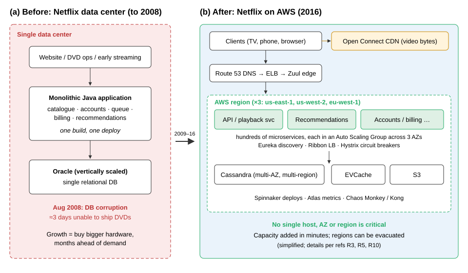
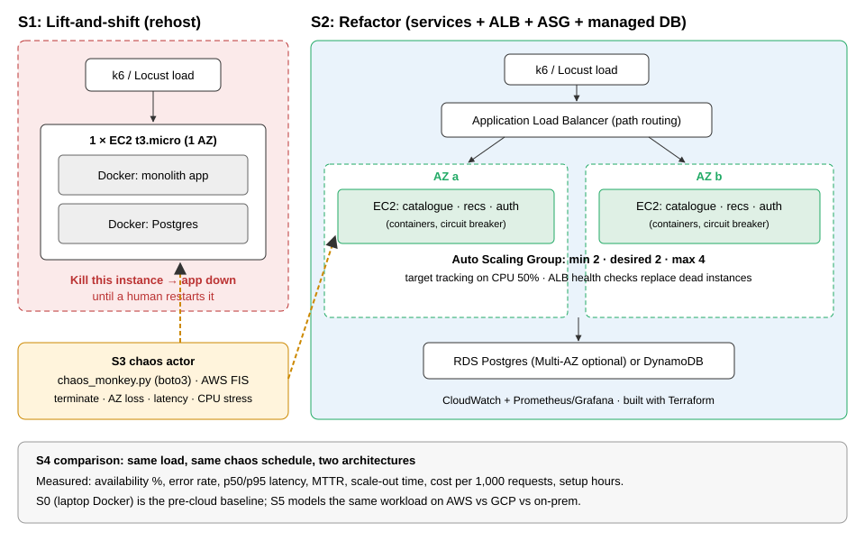

# Netflix's Migration to AWS and Chaos Engineering: Case Study and Mini-Netflix Experiment

**IT457 Cloud Computing, Case Study Project, Final Report (Week 4)**
**Project:** "Mini-Netflix: migrate, then break it on purpose" (Idea A, with a small Idea D cost model)
**Theme:** Migration and Transformation (primary), Scalability (secondary)
**Team:** _[names and roll numbers]_  **Date:** _[submission date]_

> Three kinds of statement are kept apart throughout. **Fact** means stated in a public source, cited as [Rn] (Section 12). **Estimate** means our own calculation. **Measured** means taken from our own raw data in `results/`, where every number can be recomputed with `python loadtest/analyze.py <run dir>`.

---

## 1. Introduction and objectives

Netflix is the best-known example of a company that moved its whole business from its own data center to a public cloud and then deliberately broke its own production systems to prove they could survive. The move started after a database failure in August 2008 and finished in January 2016 [R3]. Along the way Netflix created *chaos engineering*: injecting failures on purpose to find weaknesses before customers do [R4, R8, R20].

Sections 2 to 6 analyse the case. Sections 7 and 8 describe the small-scale experiment we built to reproduce the journey, and its results. Section 9 discusses the limits of that experiment.

**Objectives**

1. Explain *why* Netflix left its data center, and why it rebuilt the system instead of simply moving it.
2. Compare the architecture before and after the migration, and show which design choices removed single points of failure.
3. Explain Chaos Monkey, the Simian Army, FIT, ChAP and the principles of chaos engineering.
4. Test the central claim of the case with a measurable experiment: **moving to the cloud is not enough; the architecture is what makes a system survive failure.**
5. Measure latency, scaling behaviour, availability under failure and cost.

---

## 2. Netflix case background and problem

### 2.1 The business in 2008

In 2008 Netflix was mainly a DVD-by-mail company. It had launched online streaming in January 2007 [R11]. DVD rental tolerates outages: if the website is down for an hour, discs still go out the next day. Streaming does not. A customer who presses *play* and gets an error is lost in that moment. Netflix's strategy was moving toward streaming, so its tolerance for downtime was about to fall sharply.

### 2.2 The incident

In **August 2008** Netflix "experienced a major database corruption and for three days could not ship DVDs to our members" (**Fact**, [R3]). The failure was in one component, but because everything depended on that component, the whole business stopped.

### 2.3 Root causes

| Weakness | What it meant in practice |
|---|---|
| **Single data center** | Any site-level problem (power, network, storage) affected everything. |
| **Monolithic application** | One codebase and one deployment. A bad change or a failing module could take down the whole site, and every release had to be coordinated. |
| **One vertically scaled relational database** | The database was a single point of failure. Growing meant buying a bigger machine, which has a hard upper limit and a long lead time. |
| **Up-front capacity planning** | Hardware had to be ordered months ahead for the expected peak. Streaming demand was growing fast and was hard to predict [R1]. |
| **Undifferentiated work** | Running data centers did not make the product better, yet it consumed engineering time and capital. Netflix called this "undifferentiated heavy lifting" [R1]. |

### 2.4 Problem statement

*Netflix needed infrastructure that could grow quickly and unpredictably, with no single component whose failure could stop the service, without spending engineering effort on running data centers.*

Two obvious alternatives were rejected. A **second data center** would have reduced the single-site risk but kept the capital cost, the slow capacity planning and the monolith. A **lift-and-shift** to the cloud (the same monolith on rented servers) would have solved capacity but kept every software single point of failure. Netflix chose a third path: move to AWS **and** rebuild the system as cloud-native services [R3]. Our experiment tests exactly this difference.

---

## 3. Migration journey and timeline

### 3.1 Why AWS

Netflix explained its choice publicly in December 2010 [R1]: it did not want to keep forecasting hardware months ahead; it could draw capacity from AWS "almost instantly"; it wanted its engineers to work on the product rather than data centers; and it believed cloud computing was the future. In 2016 Netflix added that AWS "provided us with the greatest scale and the broadest set of services and features" [R3]. The stated motive was **elasticity and focus**, not lower unit cost.

### 3.2 Why it took seven years

Netflix chose to **re-architect** rather than **rehost**. In the vocabulary of the AWS migration strategies ("6 Rs") [R24], most systems were *refactored*. The 2016 post says Netflix chose "the cloud native approach, rebuilding virtually all of our technology", moving from a monolithic application to hundreds of microservices and adopting continuous delivery [R3]. Each part of the monolith had to be redesigned, the data had to move from a relational database to distributed stores with different consistency rules, and much of the tooling (deployment, discovery, monitoring) did not exist yet and had to be built. All of this happened while the service kept running for a fast-growing customer base. Netflix describes the result as "seven years of diligent effort" [R3].

### 3.3 Timeline

| Date | Event | Source |
|---|---|---|
| Jan 2007 | Streaming launched alongside DVD rental | [R11] |
| Aug 2008 | Database corruption; three days unable to ship DVDs; the cloud journey begins | [R3] |
| 2009–2010 | Non-customer-facing and then customer-facing streaming systems move to AWS | [R3] |
| Dec 2010 | "Four Reasons We Choose Amazon's Cloud" and "5 Lessons We've Learned Using AWS" published | [R1, R2] |
| Jul 2011 | "The Netflix Simian Army" post (Chaos Monkey, Chaos Gorilla, Latency Monkey and others) | [R4] |
| 2012 | Open Connect CDN announced (developed in 2011); Chaos Monkey open-sourced on 30 July 2012 | [R5, R6] |
| 24 Dec 2012 | AWS ELB failure in us-east-1 disrupts Netflix streaming on TV devices in the Americas for about 20 hours; a key motive for multi-region active-active | [R26] |
| 2013–2015 | Multi-region active-active; regional evacuation drills (Chaos Kong) | [R7, R26] |
| 20 Sep 2015 | DynamoDB disruption in us-east-1 (about 5 hours); Netflix reports no significant impact | [R26] |
| Jan 2016 | Last streaming data center components shut down; migration complete. Netflix launches in 130 new countries the same month | [R3, R11] |
| 2016–2017 | ChAP automates chaos experiments on small slices of production traffic | [R7, R21] |
| 2018 | Hystrix moved to maintenance mode; Netflix points new work to adaptive concurrency limits and resilience4j | [R10] |

### 3.4 Order of migration

The order was driven by risk. Stateless, customer-facing services, which most needed elastic scale, moved first. Billing and customer and employee data needed extra work to find a secure path to the cloud and were among the last pieces [R3]. Our plan copies this order: the stateless application tier moves first (S1, S2), and the database becomes a managed service as a separate step.

---

## 4. Architecture before and after

*Figure 1. Netflix architecture before and after the migration (simplified, drawn by the team from [R3, R5, R10]).*

### 4.1 Layer-by-layer comparison

| Layer | Before (data center) | After (AWS) | Failure it removes |
|---|---|---|---|
| **Hosting** | One owned data center | Several AWS regions, each with multiple Availability Zones (AZs) | Loss of a site, an AZ or (with failover) a region |
| **Application** | Monolith, one deployment | Hundreds of microservices, each owned by one team and deployed independently | A bug in one feature taking down the whole site |
| **Compute** | Fixed fleet of physical servers | EC2 instances in Auto Scaling Groups (ASGs), immutable machine images | Running out of capacity; a dead server needing manual replacement |
| **Traffic entry** | Hardware load balancers | DNS → Elastic Load Balancing → Zuul edge gateway | Overloaded or failed entry point; lets traffic be steered between regions |
| **Service-to-service calls** | In-process function calls | Network calls found through **Eureka**, balanced by **Ribbon**, protected by **Hystrix** (timeout, circuit breaker, fallback) | One slow dependency causing a cascading failure |
| **Data** | Relational database, scaled vertically | **Cassandra** replicated across AZs and regions, **EVCache**, S3, later DynamoDB for some uses | Loss of a database host; inability to write during a node failure |
| **Video delivery** | Third-party CDNs | **Open Connect**, Netflix's own CDN with appliances inside ISP networks | High transit cost; video crossing the open internet |
| **Delivery and operations** | Coordinated releases, separate operations team | Continuous delivery (Asgard, then Spinnaker), "you build it, you run it" | Slow, risky releases |

Sources: [R1, R2, R3, R5, R10].

### 4.2 Design principles behind the "after" picture

1. **Assume every component will fail.** Instances, AZs and even regions are treated as disposable. In 2010 Netflix wrote that the best way to avoid failure is to fail constantly [R2].
2. **Stateless services, state in replicated stores.** Any instance can be killed and replaced because none holds unique data.
3. **Scale out, not up.** Capacity comes from more small instances, added automatically by ASGs.
4. **Isolate failures.** Circuit breakers stop calls to a failing dependency, and *fallbacks* return a reduced but useful answer. If personalised recommendations fail, the user sees a generic popular list instead of an error. This is **graceful degradation**.
5. **Trade consistency for availability where it is safe.** Cassandra follows the Dynamo design and keeps accepting writes during failures, at the price of eventual consistency [R22, R23]. Billing, where correctness matters more, was treated more conservatively.

### 4.3 What the new architecture cost

The "after" picture is far more complex. Hundreds of services mean hundreds of pipelines, new kinds of network failure and debugging across many teams. Netflix had to build discovery, tracing, monitoring and deployment tools itself, and later open-sourced them [R10]. Microservices buy resilience and team speed at the price of operational complexity, which a small company may not be able to afford (Section 9).

---

## 5. Chaos engineering and resilience practices

### 5.1 The idea

An architecture designed for failure only helps if it actually works when failure happens. Real failures are rare, so fallback code paths are seldom exercised and can break unnoticed. Netflix's answer was to **cause failures deliberately, in production, during working hours**, when engineers are present. A weakness then appears as a small, controlled incident instead of a large one at night. In its first year as an open-source tool, Chaos Monkey had already terminated more than 65,000 instances in Netflix's production and test environments [R6].

### 5.2 Tools, from simple to advanced

| Tool | First described | What it breaks | What it proves |
|---|---|---|---|
| **Chaos Monkey** | 2010–11; open-sourced 2012 | Terminates random instances in an ASG | Services survive the loss of any single instance |
| **Latency Monkey** | 2011 | Adds artificial delay to service calls | Timeouts and fallbacks work; slow is handled like down |
| **Conformity, Janitor, Doctor Monkey** | 2011 | (Not failures) finds rule-breaking, unused or unhealthy resources | The fleet stays in a known state |
| **Chaos Gorilla** | 2011 | Simulates the loss of a whole Availability Zone | Services are spread across AZs and absorb the lost capacity |
| **Chaos Kong** | ~2013–15 | Evacuates a whole AWS region | Traffic can move to the other regions |
| **FIT** (Failure Injection Testing) | ~2014 | Injects error responses or latency into chosen requests | Failure can be aimed at a few users |
| **ChAP** (Chaos Automation Platform) | 2016–17 | Runs experiments on a small slice of real traffic, comparing a control group with an experiment group | Weaknesses found statistically, with an automatic stop |

Sources: [R4, R6, R7, R21].

The progression matters. Netflix started with the crudest tool (kill a random machine), widened the blast radius (AZ, region) as confidence grew, then narrowed it again with precise, automated experiments (FIT, ChAP) so that chaos was safe enough to run continuously.

### 5.3 Principles of chaos engineering

The practice was later formalised [R8, R20]:

1. **Define steady state** as a measurable output that shows normal behaviour. Netflix uses stream starts per second, because it reflects whether customers are succeeding.
2. **Hypothesise** that steady state continues in both a control and an experiment group.
3. **Introduce real-world events:** server crashes, latency, disk failure, traffic spikes.
4. **Try to disprove the hypothesis** by looking for a difference between control and experiment.
5. **Minimise the blast radius**, and stop automatically if customers are hurt.

Every experiment in Section 7 uses these five steps.

### 5.4 Evidence that it worked

On **24 December 2012** a maintenance process in AWS accidentally deleted state data for Elastic Load Balancing in us-east-1. Netflix streaming on TV devices in the US, Canada and Latin America was disrupted for about 20 hours, while European service was not affected [R26]. Netflix then invested in moving traffic between regions. On **20 September 2015**, DynamoDB in us-east-1 had high error rates for about five hours and many large AWS customers were hit, but Netflix reported no significant impact [R26]. The same kind of regional failure caused a long outage before the regional drills and very little impact after them. (Press coverage links the 2015 result to chaos engineering in general; Netflix did not publicly attribute it to one specific tool.)

### 5.5 How the practices changed

Most of the Simian Army has been retired, Chaos Monkey 2.0 was rebuilt to work through Spinnaker [R6], and Hystrix has been in maintenance mode since 2018. Netflix now favours adaptive approaches that react to real-time performance (adaptive concurrency limits) and points new projects to resilience4j [R10]. Cloud providers now offer managed chaos services such as **AWS Fault Injection Service (FIS)** [R12]. The ideas survived; the tools changed. Our exercise therefore includes a hand-written Chaos Monkey (the original idea) and FIS templates (the modern managed equivalent).

---

## 6. Outcomes, costs and lessons learned

### 6.1 Outcomes

| Outcome | Evidence |
|---|---|
| **Availability** | Availability improved steadily, toward Netflix's stated goal of "four nines" (99.99%) of service uptime [R3] |
| **Growth** | By 2016 Netflix had eight times as many streaming members as in 2008, and viewing had grown by three orders of magnitude in eight years [R3] |
| **Global expansion** | Launch in 130 new countries in January 2016 used capacity in existing AWS regions instead of new data centers [R3, R11] |
| **Speed of change** | Independent services and continuous delivery replaced coordinated releases [R3, R10] |
| **Industry influence** | Netflix OSS (Eureka, Zuul, Hystrix, Spinnaker, Chaos Monkey) shaped Spring Cloud and the cloud-native movement [R10] |

### 6.2 Cost

**Fact:** Netflix says its cloud costs per streaming start "ended up being a fraction of those in the data center", and that cost was a welcome side benefit, not the reason for moving [R3]. No exact figures are public.

**Fact:** Netflix did **not** move everything to the cloud. Video delivery, most of Netflix's bytes, runs on its own **Open Connect** CDN, developed in 2011 because Netflix believed it could be more efficient than third-party CDNs at its scale [R5].

**Analysis:** the cloud is cheapest for workloads that are *variable* and *differentiated by software*: the control plane, APIs, recommendations, and bursty encoding jobs. For a workload that is *huge, steady and predictable*, such as pushing video to every home every evening, owning the infrastructure is cheaper. Netflix's real architecture is **hybrid**: cloud for the brain, owned hardware for bulk delivery. Our S5 cost model (Section 8.6) reproduces this break-even at small scale.

### 6.3 Lessons learned

1. **Rehosting moves the problem; refactoring removes it.** A monolith on a cloud VM keeps every single point of failure it had before.
2. **Design for failure, then prove it.** Redundancy that has never been tested should be assumed broken.
3. **Measure customer-facing steady state** (stream starts, successful requests), not CPU.
4. **Widen the blast radius gradually**: instance, then AZ, then region.
5. **Migrate the least risky parts first**; keep strict-correctness systems such as billing for last.
6. **Microservices are not free.** Their operational cost pays off at Netflix's scale; a small team may do better with a modular monolith on managed services.
7. **Cloud is not automatically cheaper.** Choose per workload, as Netflix did with Open Connect.

---

## 7. Exercise design

### 7.1 Hypotheses (fixed in Week 2, before any testing)

| ID | Hypothesis | Pass criterion |
|---|---|---|
| **H1** | Lift-and-shift (S1) gains nothing in resilience: losing its one instance makes the service unavailable until a person intervenes. | Availability during the S1 kill run clearly below 99%; outage ends only on manual action |
| **H2** | The refactored deployment (S2) survives the loss of any single instance. | Availability ≥ 99% over 10 minutes with one kill every 2–3 minutes; p95 rises by no more than 2× |
| **H3** | S2 restores capacity automatically. | ASG restores desired count with no human action; time reported |
| **H4** | S2 scales out under load with acceptable latency. | p95 < 500 ms as instance count rises from 2 toward 4 |
| **H5** | A circuit breaker with fallback improves availability when one service fails. | With recommendations down, the home page still returns HTTP 200 with the breaker, and errors without it |
| **H6** | Elastic cloud is cheaper for a small, variable workload; the gap narrows or reverses for a large, steady one. | Cost model shows a break-even point between cloud and on-prem |

The thresholds (99%, 2×, 500 ms) form a simple **service level objective (SLO)** [R18].

### 7.2 Application and stages

A small **movie-catalogue** application: Python Flask with Gunicorn, Postgres seeded with movies, packaged with Docker (`app/`). Endpoints: `/health`, `/movies`, `/movies/{id}`, `/login`, `/recommendations/{user}` and `/` (the home page, which combines catalogue and recommendations and is the steady-state request).

*Figure 2. The two architectures compared, and the chaos actor that attacks both.*

| Stage | What we built | Netflix parallel | Status |
|---|---|---|---|
| **S0 Baseline** | Monolith + Postgres in Docker Compose on a laptop | Pre-2009 data center | Run |
| **local-S2** | The S2 service split (`catalogue`, `recommendations`, `auth` + Postgres) in Docker Compose, breaker on/off | Microservices + Hystrix | Run |
| **S1 Lift-and-shift** | Same container on one EC2 t3.micro, Terraform (`infra/s1`) | Rehost | Built and scripted; not run (Section 8.5) |
| **S2 Refactor** | Services in an ASG (min 2, max 4, CPU target tracking) across 2 AZs behind an ALB; RDS Postgres; Terraform (`infra/s2`), optional FIS templates | Refactor: ASGs, managed data, Hystrix | Built and scripted; not run (Section 8.5) |
| **S3/S4 Chaos** | `chaos/chaos_monkey.py` (boto3, tag-filtered, `--dry-run`, `--az`), `chaos/fault.py` (latency, service stop), `chaos/watch.py` (ASG/target health) | Chaos Monkey, Chaos Gorilla, Latency Monkey | Local faults run; AWS kills not run |
| **S5 Cost model** | `cost/cost_model.py` → `cost/cost_table.md` | Elasticity vs ownership; Open Connect | Run |

**Circuit breaker (our addition).** In S2 the catalogue service calls recommendations over HTTP (`app/src/catalogue.py`). With `BREAKER=on` the call has a 250 ms timeout and a `pybreaker` circuit breaker (opens after 5 failures, retries after 10 s), and on failure returns a generic popular list: the Hystrix pattern. With `BREAKER=off` it is a naive call with a 5 s timeout and no fallback, so errors reach the user.

### 7.3 Experiments

Steady state for every experiment: the share of `GET /` requests answered with HTTP 200 within 1 s, measured each second by our load generator (`loadtest/loadgen.py`, 20 virtual users unless stated).

| ID | Failure injected | Run on | Hypotheses |
|---|---|---|---|
| **E0** | None (baseline) | S0, local-S2 | reference |
| **E1** | Terminate a random instance every 2–3 min (S1: stop the only instance once) | S1, S2 | H1, H2, H3 |
| **E2** | Terminate every instance in one AZ | S2 | H2, H3 |
| **E3** | Add 300 ms latency to recommendations for 120 s | local-S2, breaker on/off | H5 |
| **E4** | Stop the recommendations service for 120 s | local-S2, breaker on/off (×3 each) | H5 |
| **E5** | Ramp load from 5 to 100 virtual users | S0 (S2 for scale-out) | H4 |

**Changes from the Week 2 plan.** Local runs last 5 minutes rather than 10, to keep the local suite near one hour. We used our own Python load generator instead of k6 so that every request (status, latency, serving instance, whether the fallback was used) is logged to `requests.csv`. Prometheus/Grafana were dropped in favour of the per-run timeline charts produced by `loadtest/analyze.py`.

---

## 8. Results

RESULTS_PLACEHOLDER

---

## 9. Critical discussion: limits of the simulation

- **The AWS half was not run.** H1–H4 are untested. Our local results show the *mechanism* of the case (failure isolation, graceful degradation, cost break-even) but not the self-healing behaviour of an ASG. This is the most important limitation of this report.
- **Scale.** We use one laptop and at most 4 planned instances, not tens of thousands. Effects that appear only at scale (retry storms, thundering herds, replication lag) cannot appear.
- **Local stage shares one machine.** In local-S2, the load generator and all services run on the same laptop, so they compete for CPU. Absolute latencies are therefore only comparable within a stage, not with AWS.
- **Synthetic, uniform traffic.** Real traffic has daily peaks and very different request types.
- **Few runs.** E0 and E4 have three runs each, and E3 and E5 one each. Medians with ranges are shown, but no statistical test.
- **Three services.** This cannot show the deep dependency chains that made Hystrix necessary at Netflix.
- **No regional failure.** Chaos Kong-style evacuation was out of scope for cost and time (Idea C).
- **Cost model is approximate.** Prices were not re-checked against the calculators; on-prem and staff costs are our own estimates.

---

## 10. Conclusion

Netflix's migration is often summarised as "Netflix moved to AWS", but the move itself was the smaller part. The 2008 outage was caused by single points of failure, and moving them onto rented servers would not have removed them. What made Netflix resilient was rebuilding the system around the assumption that any part can fail, and then testing that assumption by breaking things on purpose. Netflix also showed that the cloud is not the answer for every workload: its high-volume video delivery runs on its own Open Connect network.

CONCLUSION_PLACEHOLDER

---

## 11. Team roles and effort

| Role | Member | Contribution |
|---|---|---|
| Research lead | _[name]_ | Sources, case analysis (Sections 2–6), reference check |
| Cloud engineer | _[name]_ | Terraform for S1/S2 (`infra/`), ECR build script |
| Resilience and testing engineer | _[name]_ | App service split, circuit breaker, chaos scripts, load generator, local experiments |
| Analysis and report lead | _[name]_ | Analysis scripts, charts, cost model, report assembly |

Hours per stage are recorded in `docs/effort-log.md`. _[Fill in before submission.]_

---

## 12. References

All URLs accessed November 2026.

**Primary sources (Netflix and AWS)**
- [R1] Netflix Technology Blog. "Four Reasons We Choose Amazon's Cloud as Our Computing Platform." 14 Dec 2010. https://netflixtechblog.com/four-reasons-we-choose-amazons-cloud-as-our-computing-platform-4aceb692afec
- [R2] Netflix Technology Blog. "5 Lessons We've Learned Using AWS." Dec 2010. https://netflixtechblog.com/5-lessons-weve-learned-using-aws-1f2a28588e4c
- [R3] Izrailevsky, Y., Vlaovic, S. and Meshenberg, R. "Completing the Netflix Cloud Migration." Netflix, 12 Feb 2016. https://about.netflix.com/en/news/completing-the-netflix-cloud-migration
- [R4] Izrailevsky, Y. and Tseitlin, A. "The Netflix Simian Army." Netflix Technology Blog, 19 Jul 2011. https://netflixtechblog.com/the-netflix-simian-army-16e57fbab116
- [R5] Netflix. "How Netflix works with ISPs around the globe to deliver a great viewing experience" and Open Connect overview. https://about.netflix.com/en/news/how-netflix-works-with-isps-around-the-globe-to-deliver-a-great-viewing-experience ; https://openconnect.netflix.com
- [R6] Netflix Technology Blog. "Chaos Monkey Released Into The Wild." 30 Jul 2012, http://techblog.netflix.com/2012/07/chaos-monkey-released-into-wild.html ; Netflix/chaosmonkey repository. https://github.com/Netflix/chaosmonkey
- [R7] Netflix Technology Blog. "FIT: Failure Injection Testing" (2014); "ChAP: Chaos Automation Platform" (2017). https://netflixtechblog.com
- [R10] Netflix Open Source Software: Eureka, Zuul, Ribbon, Hystrix (README: maintenance mode), Spinnaker. https://github.com/Netflix ; https://github.com/Netflix/Hystrix
- [R11] Netflix, Inc. Quarterly investor letters and Form 10-K filings. https://ir.netflix.net
- [R26] Contemporary reports of the AWS events: TechCrunch, "Netflix crippled on Christmas Eve by AWS outages," 24 Dec 2012, https://techcrunch.com/2012/12/24/netflix-crippled-on-christmas-eve-by-aws-outages/ ; GeekWire, "Amazon explains Christmas Eve outage," 2013, https://www.geekwire.com/2013/netflix-nightmare-amazon-explains-christmas-eve-outage-issues-apology/ ; The Register, "AWS outage explained," 23 Sep 2015, https://www.theregister.com/2015/09/23/aws_outage_explained ; Data Center Knowledge, "Amazon Data Center Outage Affects Netflix, Heroku, Others," 21 Sep 2015.

**Chaos engineering and distributed systems**
- [R8] Principles of Chaos Engineering. https://principlesofchaos.org
- [R9] Rosenthal, C. and Jones, N. *Chaos Engineering: System Resiliency in Practice.* O'Reilly, 2020.
- [R20] Basiri, A. et al. "Chaos Engineering." *IEEE Software* 33(3), 2016.
- [R21] Basiri, A. et al. "Automating Chaos Experiments in Production." ICSE-SEIP 2019, arXiv:1905.04648; Blohowiak, A. et al. "A Platform for Automating Chaos Experiments." IEEE ISSREW 2016, arXiv:1702.05849.
- [R22] DeCandia, G. et al. "Dynamo: Amazon's Highly Available Key-value Store." SOSP, 2007.
- [R23] Lakshman, A. and Malik, P. "Cassandra: A Decentralized Structured Storage System." ACM SIGOPS OSR 44(2), 2010.

**Tools and methods used in the exercise**
- [R12] AWS. *AWS Fault Injection Service User Guide.* https://docs.aws.amazon.com/fis/
- [R14] HashiCorp. Terraform AWS Provider documentation. https://registry.terraform.io/providers/hashicorp/aws
- [R16] AWS Well-Architected Framework, Reliability Pillar. https://docs.aws.amazon.com/wellarchitected/latest/reliability-pillar/ ; pybreaker. https://github.com/danielfm/pybreaker
- [R18] Beyer, B. et al. *Site Reliability Engineering.* O'Reilly, 2016 (chapters on SLOs and error budgets).
- [R19] AWS EC2, RDS, ELB and public IPv4 pricing pages; AWS and Google Cloud pricing calculators.
- [R24] AWS Prescriptive Guidance. "Migration strategies" (the 6 Rs / 7 Rs). https://docs.aws.amazon.com/prescriptive-guidance/latest/large-migration-guide/migration-strategies.html
- [R25] Fowler, M. and Lewis, J. "Microservices." martinfowler.com, 2014. https://martinfowler.com/articles/microservices.html
