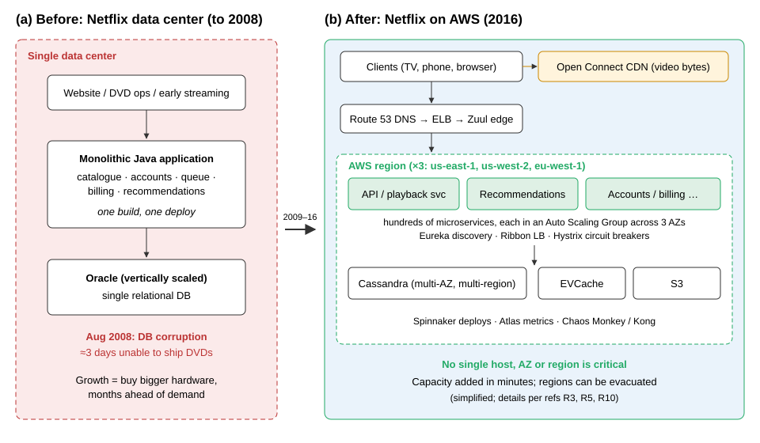
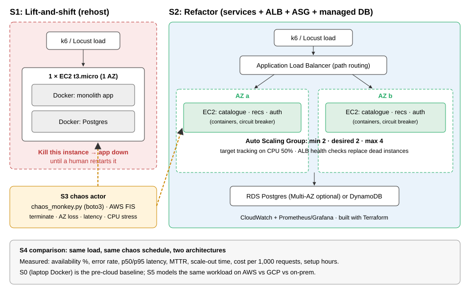

# Netflix's Migration to AWS and Chaos Engineering: Case Analysis and Exercise Plan

**IT457 Cloud Computing, Case Study Project, Week 2 Report**
**Project:** "Mini-Netflix: migrate, then break it on purpose" (Idea A, with a small Idea D cost model)
**Theme:** Migration and Transformation (primary), Scalability (secondary)
**Team:** _[names and roll numbers]_  **Date:** _[submission date]_

> **Status: DRAFT.** Facts carried over from the Week 1 summary are cited with reference numbers [Rn] (Section 11). Items still marked **[verify]** must be checked against the source before final submission. We separate three kinds of statement throughout: **Fact** (stated in a public source), **Estimate** (our own calculation) and **Our addition** (something we do that Netflix did not).

---

## 1. Introduction and objectives

Netflix is the best-known example of a company moving its whole business from its own data center to a public cloud and then deliberately breaking its own production systems to prove they could survive. The move started after a database failure in 2008 and ended in January 2016 [R3]. Along the way Netflix created *chaos engineering*, the practice of injecting failures on purpose to find weaknesses before customers do [R4, R8, R20].

This report has two parts. Sections 2 to 6 analyse the case: the problem, the migration, the architecture before and after, the resilience practices, and the outcomes and costs. Sections 7 to 9 describe the exercise we will build in Week 3, in which we reproduce Netflix's journey at small scale and measure it.

**Objectives**

1. Explain *why* Netflix left its data center and *why* it rebuilt the system instead of simply moving it.
2. Compare the architecture before and after the migration, and show which design choices removed single points of failure.
3. Explain Chaos Monkey, the Simian Army, ChAP and the principles of chaos engineering.
4. Design a measurable experiment that tests the central claim of the case: **moving to the cloud is not enough; the architecture is what makes a system survive failure.**
5. Measure latency, scaling behaviour, availability under failure and cost, as the course requires.

---

## 2. Netflix case background and problem

### 2.1 The business in 2008

In 2008 Netflix was mainly a DVD-by-mail company that had launched online streaming the year before (2007). DVD rental is tolerant of outages: if the website is down for an hour, discs still go out the next day. Streaming is not. A streaming customer who presses *play* and gets an error is lost in that moment, and possibly for good. The company's strategy was moving toward streaming, so its tolerance for downtime was about to drop sharply.

### 2.2 The incident

In **August 2008** Netflix suffered a major database corruption in its own data center and **for three days could not ship DVDs** to its members (**Fact**, [R3]). The failure was in one component, but because everything depended on that component, the whole business stopped.

### 2.3 Root causes

The incident exposed structural problems rather than a one-off bug:

| Weakness | What it meant in practice |
|---|---|
| **Single data center** | Any site-level problem (power, network, storage) affected everything. |
| **Monolithic application** | One codebase and one deployment. A bad change or a failing module could take down the whole site, and teams had to coordinate every release. |
| **One vertically scaled relational database (Oracle)** | The database was a single point of failure. Growing meant buying a bigger machine, which has a hard upper limit and a long lead time. |
| **Up-front capacity planning** | Hardware had to be ordered months ahead for the expected peak. Streaming demand was growing fast and was hard to predict, so Netflix risked either running out of capacity or paying for idle machines. |
| **Undifferentiated work** | Running data centers did not make Netflix's product better for customers, yet it consumed engineering time and capital. [R1] |

### 2.4 Problem statement

Stated in one sentence: *Netflix needed an infrastructure that could grow quickly and unpredictably, with no single component whose failure could stop the service, without spending its engineering effort on running data centers.*

Two obvious alternatives were available and both were rejected. A **second data center** would have reduced the single-site risk but kept the capital cost, the slow capacity planning and the monolith. A **lift-and-shift to the cloud** (moving the same monolith onto rented servers) would have solved capacity but kept every single point of failure in software. Netflix chose a third option: move to AWS **and** rebuild the system as cloud-native services [R3]. Our experiment (Section 7) tests exactly this difference, by building both the lift-and-shift version and the rebuilt version and failing them in the same way.

---

## 3. Migration journey and timeline

### 3.1 Why AWS

Netflix gave its reasons publicly in 2010 [R1]. In summary: AWS was the only provider at the time with the scale and range of services Netflix needed; it let Netflix add capacity in minutes instead of months; it removed large capital purchases; and it let engineers focus on the product. Netflix's stated motive was **elasticity and speed**, not a promise of lower unit cost (**Fact**, [R1] **[verify]** exact wording).

### 3.2 Why it took seven years

Netflix chose to **re-architect** rather than **rehost**. In the vocabulary of AWS's "6 Rs" of migration [R24], most systems were *refactored*, not *rehosted*. Each piece of the monolith had to be redesigned as a service, the data had to move from Oracle to a distributed store with different consistency rules, and new tooling had to be built for deployment, discovery and monitoring, because most of it did not exist yet in 2009. Netflix also kept the service running for a growing customer base throughout. Izrailevsky's 2016 post says the company deliberately took "the cloud native approach", and that this was slower but gave a better result than moving everything as it was [R3].

### 3.3 Timeline

| Year | Event | Source |
|---|---|---|
| 2007 | Streaming launched alongside DVD rental | [R11] **[verify]** |
| Aug 2008 | Database corruption; ~3 days unable to ship DVDs | [R3] |
| 2009 | Migration begins; first non-customer-facing workloads moved to AWS | [R3] **[verify]** |
| 2010 | Customer-facing streaming services running on AWS; "Four Reasons" and "5 Lessons" posts published; Chaos Monkey in use | [R1, R2] |
| Jan 2011 | Expansion beyond the US and Canada begins (Latin America later in 2011) | [R11] **[verify]** |
| Jul 2011 | "The Netflix Simian Army" post | [R4] |
| 2012 | Chaos Monkey open-sourced; Open Connect CDN announced; Eureka released | [R5, R6, R10] |
| Dec 2012 | AWS ELB outage in us-east-1 disrupts Netflix on Christmas Eve, a key motive for multi-region active-active | [R26] **[verify]** |
| 2013–2015 | Multi-region active-active; Chaos Kong regional evacuation drills; Spinnaker released (2015) | [R7, R10] **[verify]** |
| Sep 2015 | DynamoDB disruption in us-east-1; Netflix recovers quickly by shifting traffic between regions | [R26] **[verify]** |
| Jan 2016 | Last data center pieces (billing, customer and employee data) shut down; migration complete. Netflix launches in 130 new countries in the same month | [R3] |
| 2016–2017 | FIT and then ChAP make chaos experiments safer and automated | [R7] |

### 3.4 Order of migration

The order was risk-driven. Stateless, customer-facing services (the parts that most needed elastic scale) moved first. Systems with strict consistency or compliance needs, above all **billing and payment**, moved last, because they were the riskiest to get wrong and gained least from elasticity [R3]. This is a pattern we copy in our own plan: we move the stateless application tier first (S1, S2) and treat the database migration as a separate, carefully measured step.

---

## 4. Architecture before and after

*Figure 1. Netflix architecture before and after the migration (simplified, drawn by the team from [R3, R5, R10]).*

### 4.1 Layer-by-layer comparison

| Layer | Before (data center) | After (AWS) | Failure it removes |
|---|---|---|---|
| **Hosting** | One owned data center | Three AWS regions, each with three Availability Zones (AZs) | Loss of a site, an AZ or (with failover) a region |
| **Application** | Java monolith, one deploy | Hundreds of microservices, each owned by one team and deployed independently | A bug or crash in one feature taking down the whole site |
| **Compute** | Fixed fleet of physical servers | EC2 instances in Auto Scaling Groups (ASGs), immutable machine images | Running out of capacity; a dead server needing manual replacement |
| **Traffic entry** | Hardware load balancers | Route 53 DNS → Elastic Load Balancing → Zuul edge gateway | Overloaded or failed entry point; lets traffic be steered between regions |
| **Service-to-service calls** | In-process function calls | Network calls found through **Eureka** (service discovery), balanced by **Ribbon**, protected by **Hystrix** (circuit breaker, timeout, fallback) | One slow dependency causing a chain reaction (cascading failure) |
| **Data** | Oracle, scaled vertically | **Cassandra** (replicated across AZs and regions), **EVCache** (memcached-based cache), S3, later DynamoDB for some uses | Loss of a database host; inability to write during a node failure |
| **Video delivery** | Third-party CDNs | **Open Connect**, Netflix's own CDN with appliances placed inside ISPs | High transit cost; video traffic crossing the open internet |
| **Delivery and operations** | Manual releases, separate ops team | Continuous delivery (Asgard, then **Spinnaker**), "you build it, you run it" | Slow, risky, coordinated releases |

Sources: [R1, R2, R3, R5, R10]. Component names to be double-checked against [R10] **[verify]**.

### 4.2 Key design principles behind the "after" picture

1. **Assume every component will fail.** Instances, AZs and even regions are treated as disposable. Netflix's "5 Lessons" post states this directly: the best way to avoid failure is to fail constantly [R2].
2. **Stateless services, state in replicated stores.** Any instance can be killed and replaced because no instance holds unique data. All state lives in Cassandra, EVCache or S3, which keep several copies.
3. **Scale out, not up.** Capacity is added by running more small instances, not by buying a bigger one. ASGs do this automatically.
4. **Isolate failures.** Circuit breakers stop calls to a failing dependency, and *fallbacks* return a reduced but useful answer. For example, if personalised recommendations fail, the user sees a generic popular list instead of an error page. This is called **graceful degradation**.
5. **Trade consistency for availability where it is safe.** Cassandra is *eventually consistent*: a write may take a short time to reach all replicas, but the system keeps accepting writes during failures. This follows the Dynamo design [R22, R23]. Billing, where correctness matters more, was handled more conservatively and moved last.

### 4.3 What the new architecture cost

The "after" picture is far more complex. Hundreds of services mean hundreds of deployment pipelines, network calls that can fail in new ways, and debugging that crosses many teams. Netflix had to build service discovery, tracing, monitoring and deployment tools itself, and then open-source them [R10]. This is an honest trade-off we will discuss in Section 10: microservices buy resilience and team speed at the price of operational complexity, which a small company may not be able to afford.

---

## 5. Chaos engineering and resilience practices

### 5.1 The idea

An architecture designed for failure only helps if it actually works when failure happens. Failures in a large distributed system are rare and unpredictable, so the fallback code paths are seldom exercised and can rot unnoticed. Netflix's answer was to **cause failures deliberately, in production, during working hours**, when engineers are present to respond. A weakness then shows up as a small, controlled incident instead of a large one at 3 a.m. [R2, R4].

### 5.2 Tools, from simple to advanced

| Tool | Year | What it breaks | What it proves |
|---|---|---|---|
| **Chaos Monkey** | 2010–11 | Terminates random production instances in an ASG | Services survive the loss of any single instance |
| **Latency Monkey** | 2011 | Adds artificial delay to service calls | Timeouts and fallbacks work; slow is handled like down |
| **Conformity / Janitor / Doctor Monkey** | 2011 | (Not failures) finds instances breaking rules, unused resources, unhealthy hosts | Hygiene: the fleet stays in a known state |
| **Chaos Gorilla** | 2011 | Simulates the loss of a whole Availability Zone | Services are balanced across AZs and can absorb the lost capacity |
| **Chaos Kong** | ~2013–15 | Evacuates a whole AWS region | Traffic can move to the other regions and they can absorb it |
| **FIT** (Failure Injection Testing) | 2014 | Injects failures into specific requests, tagged at the edge | Failure can be targeted at a few users, limiting damage |
| **ChAP** (Chaos Automation Platform) | 2016–17 | Runs automated experiments on a small slice of real traffic, comparing a "control" group to an "experiment" group | Weaknesses found statistically, with automatic stop if customers are hurt |

Sources: [R4, R6, R7]. Years marked approximate; **[verify]** each against the original post.

The progression matters: Netflix started with the crudest possible tool (kill a random machine), then widened the blast radius (AZ, region) as confidence grew, then narrowed it again with precise, automated experiments (FIT, ChAP) to make chaos safe enough to run all the time.

### 5.3 Principles of chaos engineering

Netflix engineers later formalised the practice [R8, R20]. An experiment follows these steps:

1. **Define steady state** as a measurable output that shows normal behaviour. Netflix uses *stream starts per second* (SPS), because it reflects whether customers are succeeding, not whether servers are busy.
2. **Hypothesise** that steady state will continue in both the control and the experiment group.
3. **Introduce real-world events**: server crashes, network latency, disk failure, traffic spikes.
4. **Try to disprove the hypothesis** by looking for a difference between control and experiment.
5. **Minimise the blast radius** so that a failed experiment hurts as few users as possible, and stop automatically if it does.

We adopt these five steps as the template for every experiment in Section 7.4.

### 5.4 Evidence that it worked

The best-known evidence is the **September 2015 DynamoDB disruption in AWS us-east-1**, which affected many large AWS customers. Netflix reported only a brief impact because it had practised regional evacuation with Chaos Kong and could move traffic to another region [R26] **[verify]**. By contrast, the **Christmas Eve 2012 ELB outage** in the same region did disrupt Netflix streaming, and was one of the triggers for the multi-region active-active design [R26] **[verify]**. Together these two events show the value of the practice: the same kind of regional failure caused an outage before the drills and only a short disruption after them.

### 5.5 How the practices changed over time

Several original tools are now retired or replaced. Most of the Simian Army was retired; Chaos Monkey 2.0 was rebuilt to work through Spinnaker; and Hystrix was put into maintenance mode in 2018, with Netflix pointing users to adaptive concurrency limits and libraries such as Resilience4j [R6, R10] **[verify]**. Cloud providers now offer managed chaos services, such as **AWS Fault Injection Service (FIS)** [R12]. The ideas survived; the tools changed. This is why our exercise uses both a hand-written Chaos Monkey (to reproduce the original) and AWS FIS (to show the modern equivalent).

---

## 6. Outcomes, costs and lessons learned

### 6.1 Outcomes

| Outcome | Evidence |
|---|---|
| **Higher availability** | Netflix reported service availability approaching "four nines" (99.99%) by 2016, an improvement on the data center era [R3] **[verify]** figure |
| **Growth** | Streaming membership grew roughly eight-fold between 2008 and 2016, and viewing grew by an order of magnitude, without Netflix building new data centers [R3] **[verify]** |
| **Global expansion** | Launch in 130 new countries in January 2016 was possible because capacity could be added in existing AWS regions [R3, R11] |
| **Speed of change** | Independent services and continuous delivery let teams ship many changes per day instead of coordinated releases [R10] |
| **Industry influence** | Netflix OSS (Eureka, Zuul, Hystrix, Spinnaker, Chaos Monkey) shaped Spring Cloud and the later cloud-native movement [R10] |

### 6.2 Cost

**Fact:** Netflix has said that its cloud costs per streaming start ended up being a *fraction* of the data center cost, and described this as a welcome side benefit rather than the reason for moving [R3] **[verify]** wording. No exact figures or percentages are public.

**Fact:** Netflix did **not** move everything to the cloud. Video delivery, which accounts for most of Netflix's bytes, runs on its own **Open Connect** CDN, made of appliances placed inside internet service providers' networks [R5].

**Analysis (our view):** the cloud is cheapest for workloads that are *variable* and *differentiated by software*: control plane, APIs, recommendations, encoding jobs that run in bursts. For a workload that is *huge, steady and predictable*, such as pushing video bytes to every home every evening, owning the infrastructure is cheaper than renting it. Netflix's real architecture is therefore **hybrid**: cloud for the brain, owned hardware for the bulk delivery. This is the key counter-example to "the cloud is always cheaper", and our S5 cost model (Section 7) is designed to show the same break-even effect at small scale.

### 6.3 Lessons learned

1. **Rehosting moves the problem; refactoring removes it.** A monolith on a cloud VM still has every single point of failure it had before.
2. **Design for failure, then prove it.** Redundancy that has never been tested should be assumed broken.
3. **Measure customer-facing steady state** (stream starts, successful requests), not server metrics such as CPU.
4. **Start small and widen the blast radius gradually** (instance → AZ → region).
5. **Migrate the least risky parts first**, and keep systems with strict correctness requirements (billing) for last.
6. **Microservices are not free.** Their operational cost is justified at Netflix's scale; for a small team a well-built modular monolith on managed services may be the better choice.
7. **Cloud is not automatically cheaper.** Choose per workload, as Netflix did with Open Connect.

---

## 7. Exercise plan and design

### 7.1 Aim and hypotheses

We reproduce Netflix's journey in miniature and test the central claim of the case. Our hypotheses are:

| ID | Hypothesis | Pass criterion (set before testing) |
|---|---|---|
| **H1** | A lift-and-shift deployment (S1) gains nothing in resilience: killing its one instance makes the service unavailable until a person intervenes. | Availability during the S1 chaos run is clearly below the 99% SLO, and the outage ends only on manual action |
| **H2** | The refactored deployment (S2) survives the loss of any single instance with little customer impact. | Availability ≥ 99% during a 10-minute run with one instance killed every 2–3 minutes; p95 latency rises by no more than 2× during recovery |
| **H3** | S2 recovers capacity automatically. | ASG restores the desired count with no human action; we report the time to restore (expected order: a few minutes, dominated by instance boot and health check grace) |
| **H4** | S2 scales out under load and latency stays acceptable. | p95 latency stays under 500 ms as load rises, while instance count increases from 2 toward 4 |
| **H5** | A circuit breaker with fallback (graceful degradation) improves availability when one service fails. | With the recommendations service down, the home page still returns HTTP 200 (generic list) with the breaker, and errors without it |
| **H6** | Elastic cloud is cheaper than owned hardware for a small, variable workload, but the gap narrows or reverses for a large, steady one. | S5 cost model shows a break-even point between AWS and on-prem |

The thresholds (99%, 2×, 500 ms) are our own choices, set as a simple **service level objective (SLO)** [R18]. We fix them now so that the results cannot be bent to fit afterwards.

### 7.2 The application

A small **movie-catalogue** web application, deliberately simple, because the experiment is about *where and how* it runs, not the app itself.

| Endpoint | Purpose |
|---|---|
| `GET /health` | Health check for the load balancer (returns 200 if the app and DB connection are fine) |
| `GET /movies`, `GET /movies/{id}` | Catalogue: list and detail, read from the database |
| `POST /login` | Auth: issues a simple token for a seeded test user |
| `GET /recommendations/{user}` | Recommendations: returns a list based on genre; in S2 it is a separate service, with a fallback |
| `GET /` | Home page that combines the catalogue and recommendations (the "steady state" request) |

Stack: Python **Flask** with Gunicorn, **Postgres** (seeded with ~1,000 movies from a public sample dataset or generated data), packaged with **Docker**. In S0 and S1 all of this is one container plus one database container (the monolith). In S2 the code is split into three containers: `catalogue`, `recommendations` and `auth`.

### 7.3 Stages

*Figure 2. The two architectures we compare and the chaos actor that attacks both.*

| Stage | What we build | Netflix parallel | What we measure |
|---|---|---|---|
| **S0 Baseline** | Monolith + Postgres in Docker Compose on a laptop | Pre-2009 data center | Local p50/p95 latency, max requests/s |
| **S1 Lift-and-shift** | The same containers on **one EC2 t3.micro** in one AZ, built with Terraform | "Rehost": early cloud, still a single point of failure | Latency vs S0, setup hours, hourly cost |
| **S2 Refactor** | Three services on EC2 in an **Auto Scaling Group** (min 2, desired 2, max 4) across **2 AZs**, behind an **Application Load Balancer**; database on **RDS Postgres** (or DynamoDB); circuit breaker on the recommendations call; CloudWatch plus Prometheus/Grafana dashboards; all via Terraform | "Refactor": microservices, ASGs, managed data store, Hystrix | Latency vs instance count, scale-out time, setup hours, hourly cost |
| **S3 Chaos** | `chaos/chaos_monkey.py` (boto3) and AWS FIS experiment templates | Chaos Monkey, Chaos Gorilla, Latency Monkey | Availability, error rate, latency spike, time to recover |
| **S4 Compare** | The same load and the same chaos schedule against S1 and S2 | Why Netflix rebuilt instead of rehosting | Side-by-side results table and timelines |
| **S5 Cost model** | AWS and GCP pricing calculators and an on-prem estimate for a Netflix-like workload, plus our measured cost per 1,000 requests | Elasticity vs ownership; Open Connect | Monthly cost table, break-even chart |

**Stretch goals (only if time allows):** S2b, the same services on ECS Fargate (containers instead of VMs, compare scale-out time); a Lambda version of the recommendations endpoint (cold start and cost per 1,000 requests); a Spot vs On-Demand cost comparison for the ASG.

### 7.4 Chaos experiments

Every experiment follows the five chaos principles in Section 5.3. **Steady state** for all experiments: the percentage of `GET /` requests that return HTTP 200 within 1 second, measured by the load generator every second.

| ID | Failure injected | Tool | Run on | Hypothesis tested | Blast radius limit and stop condition |
|---|---|---|---|---|---|
| **E1** | Terminate one random instance every 2–3 minutes for 10 minutes | `chaos_monkey.py` | S1 and S2 | H1, H2, H3 | Only instances tagged `project=mini-netflix`; script refuses to run if the tag filter matches more than 4 instances |
| **E2** | Terminate all instances in one AZ ("mini Chaos Gorilla") | `chaos_monkey.py --az` or FIS | S2 | H2, H3 | Same tag filter; one run only |
| **E3** | Add 300 ms latency to the recommendations service | FIS network action or `tc netem` on the instance | S2 with and without breaker | H5 | Duration 5 minutes; FIS stop condition on a CloudWatch alarm |
| **E4** | Stop the recommendations service entirely | `docker stop` via SSM | S2 with and without breaker | H5 | 5 minutes |
| **E5** | CPU stress on all instances (forces scale-out) | FIS CPU stress or `stress-ng`, plus rising load | S2 | H4 | Max 4 instances (ASG limit caps cost) |

**Mini Chaos Monkey design** (`chaos/chaos_monkey.py`): lists running EC2 instances with the project tag; picks one at random; logs a timestamp; calls `terminate_instances`; sleeps for a random interval; repeats until the duration ends. It has a `--dry-run` flag, an `--az` option for E2, and writes every kill to `results/chaos_events.csv` so that kill times can be marked on the charts. A run of E1 against S1 must use **stop** instead of **terminate**, so the single instance can be restarted by hand and the manual recovery time measured.

### 7.5 Load generation and measurement

- **Load generator:** k6 (or Locust), run from a separate machine (a laptop or a small EC2 instance in a different AZ), so the load generator itself is not a victim of chaos.
- **Load profiles:** *steady* (constant 20 virtual users for 10 minutes, used during chaos runs) and *ramp* (from 5 to 100 virtual users over 10 minutes, used for E5 and scaling charts). Exact numbers will be tuned in S0 so that one t3.micro is busy but not saturated at the steady level.
- **Repetitions:** each experiment runs **3 times**; we report the median and the range.

| Metric | Definition | Source |
|---|---|---|
| Availability % | Successful `GET /` requests (HTTP 200, < 1 s) ÷ all requests | k6 output CSV |
| Error rate | 1 − availability, plus breakdown by status code (5xx, timeouts) | k6 |
| p50 / p95 latency | Median and 95th-percentile response time, per 10-second window | k6 |
| Time to detect | Kill time → ALB marks target unhealthy | Chaos log + ALB target health (CloudWatch) |
| Time to restore capacity | Kill time → ASG replacement passes health check | Chaos log + ASG activity history |
| Customer-visible outage | Longest continuous period with availability < 99% | k6 |
| Scale-out time | Alarm trigger → new instance in service | ASG activity history |
| Cost per 1,000 requests | Hourly cost of the stage ÷ requests per hour served at the steady load × 1,000 | Pricing pages + k6 |
| Setup effort | Hours to build each stage | `docs/effort-log.md` |

**Planned charts** (Week 3): (1) p95 latency vs instance count; (2) requests/s over time with instance count overlay (E5); (3) availability timeline with kill events marked, S1 and S2 on the same axes (E1); (4) MTTR bar chart per failure type; (5) cost per stage and cost per 1,000 requests; (6) setup hours per stage; (7) S5 break-even chart.

### 7.6 Cost model (S5) method

We model a simplified "Netflix-like" workload: API/compute tier, database, object storage and data transfer out. For three sizes (small, medium, large), we price it on **AWS** and **GCP** using their pricing calculators, and on **on-prem** using our own estimate (server purchase price spread over 3–5 years, plus power, space, network and an estimated staff cost). We then plot monthly cost against workload size and look for the break-even point. All on-prem and staff numbers are **Estimates** and will be labelled as such, with every assumption listed in `cost/`.

**Expected cost of our AWS experiments (Estimate, us-east-1 on-demand, to be checked against [R19]):**

| Resource | Approx. hourly price | Notes |
|---|---|---|
| EC2 t3.micro | ~$0.0104 | Free-tier eligible on new accounts |
| Application Load Balancer | ~$0.0225 + LCU charge | Only running in S2 sessions |
| RDS db.t3.micro Postgres (single-AZ) | ~$0.017 | Multi-AZ roughly doubles this |
| Public IPv4 address | ~$0.005 per address | Charged since Feb 2024 |
| **S2 session (2–4 instances, ALB, RDS) for 3 hours** | **≈ $0.25–$0.50** | Well within a $5 budget if torn down after each session |

### 7.7 Tools and repository layout

| Area | Tool |
|---|---|
| Cloud | AWS: EC2, ALB, Auto Scaling, RDS or DynamoDB, CloudWatch, FIS, Systems Manager |
| Infrastructure as Code | Terraform (one module per stage, `terraform destroy` after each session) |
| App | Python, Flask, Gunicorn, Docker, Docker Compose, pybreaker (circuit breaker) |
| Load and chaos | k6 or Locust; Python + boto3 |
| Observability | CloudWatch, Prometheus, Grafana |
| Analysis | Python, pandas, matplotlib |
| Diagrams | draw.io / SVG |

Code and evidence live in the existing folders: `app/`, `infra/`, `chaos/`, `loadtest/`, `results/` (raw CSVs, charts, screenshots) and `cost/`.

### 7.8 Risks and mitigations

| Risk | Likelihood | Impact | Mitigation |
|---|---|---|---|
| Unexpected AWS bill | Medium | High | $5 AWS Budget alert **before** any build; t3.micro only; ASG max 4; `terraform destroy` after every session; no NAT gateway |
| Chaos script kills the wrong resource | Low | High | Strict tag filter, instance count guard, `--dry-run` first, separate AWS account or region for the project |
| AWS Academy account blocks some services (e.g., FIS, IAM roles) | Medium | Medium | Check permissions in Week 2; fall back to boto3 script and `tc netem` for latency |
| Load generator becomes the bottleneck | Medium | Medium | Check its CPU during runs; run it from a separate machine |
| Results are noisy | Medium | Low | 3 repetitions per experiment; report median and range |
| Running out of time | Medium | Medium | Incremental plan: S0–S2 alone is a complete result; chaos (S3–S4) and stretch goals are added on top |

### 7.9 Ethics and safety

All experiments run only on resources we create in our own AWS account. No real users, no personal data and no third-party systems are involved. The chaos script is restricted by tags and will not run without an explicit target filter.

---

## 8. Results (placeholder, completed in Week 3)

This section will contain, for each experiment: the method actually used (including any changes from Section 7), raw data location in `results/`, the charts listed in Section 7.5, and a short analysis against hypotheses H1 to H6.

| Hypothesis | Result | Accepted / rejected |
|---|---|---|
| H1 | _to be measured_ | |
| H2 | _to be measured_ | |
| H3 | _to be measured_ | |
| H4 | _to be measured_ | |
| H5 | _to be measured_ | |
| H6 | _to be measured_ | |

---

## 9. Team roles and work plan

### 9.1 Roles

| Role | Member | Responsibilities | Week 3 deliverables |
|---|---|---|---|
| **Research lead** | _[name]_ | Verify all **[verify]** items, complete the reading tracker, references, Netflix timeline | Final reference list; Sections 2–6 checked |
| **Cloud engineer** | _[name]_ | AWS account and budget, Terraform for S1 and S2, ASG, ALB, RDS, IAM | `infra/` Terraform; S1 and S2 running; screenshots |
| **Resilience and testing engineer** | _[name]_ | App split into services, circuit breaker, `chaos_monkey.py`, FIS templates, k6 scripts, running experiments E1–E5 | `chaos/`, `loadtest/`, raw CSVs in `results/` |
| **Analysis and report lead** | _[name]_ | Charts, S5 cost model, effort log, report assembly, viva slides | `results/` charts; `cost/` tables; merged report |

Every member keeps `docs/effort-log.md` up to date, and every member must be able to explain the whole pipeline in the viva.

### 9.2 Schedule

| Week | Work | Owner(s) |
|---|---|---|
| **2** (this week) | Case analysis (this report); diagrams; experiment design; set AWS budget alert; check AWS Academy permissions; write the S0 app | All; app by Resilience engineer |
| **3**, days 1–2 | S0 baseline tests; S1 Terraform and tests | Cloud engineer, Testing engineer |
| **3**, days 3–4 | S2 build; scaling tests (E5) | Cloud engineer, Testing engineer |
| **3**, days 5–6 | Chaos experiments E1–E4 on S1 and S2; S5 cost model | Testing engineer, Analysis lead |
| **3**, day 7 | Charts and results section draft | Analysis lead |
| **4** | Merge, polish charts, proofread, check references | All |
| **5** | Viva rehearsal; record a backup demo video | All |

---

## 10. Critical discussion: limits of our simulation

Our experiment is a small model of Netflix, and the report must be clear about what it can and cannot show.

- **Scale.** We run 2–4 instances, not tens of thousands. Effects that only appear at scale (retry storms, thundering herds, metadata service limits, cross-region data replication lag) will not appear.
- **Synthetic traffic.** Our load is generated and uniform. Real traffic has daily peaks, regional patterns and very different request types.
- **Fewer services.** Three services cannot show the full dependency-chain problems that circuit breakers solve at Netflix.
- **Region-level failure is out of scope.** We test instance and AZ loss, not a full regional evacuation (Chaos Kong). That would need two regions and data replication, which is beyond our budget and time (it was Idea C).
- **Not in production.** Netflix runs chaos experiments on real customers with automated safety controls. Ours run on a test system, so we cannot measure real customer impact.
- **Cost model is approximate.** On-prem and staff costs are our own estimates; cloud prices change and differ by region and discount.

What the experiment **can** show is the core mechanism of the case: the same application, the same failure, and a clear difference in outcome that depends only on the architecture.

---

## 11. Conclusion

Netflix's migration is often summarised as "Netflix moved to AWS", but the case shows that the move itself was the smaller part. The 2008 outage was caused by single points of failure, and moving those single points of failure onto rented servers would not have removed them. What made Netflix resilient was the decision to rebuild the system around the assumption that any part can fail at any time, and then to keep testing that assumption by breaking things on purpose. Netflix also showed that the cloud is not the answer for every workload: it kept its high-volume video delivery on its own Open Connect network.

Our Week 3 exercise tests this directly. We will run the same small application as a lift-and-shift deployment and as a refactored, auto-scaled, multi-AZ deployment, apply the same failures to both, and measure availability, latency, recovery time, scaling and cost against hypotheses fixed in advance.

---

## 12. References

_Titles and dates below follow the Week 1 reading tracker. Before final submission, add the exact URL, author and access date in the course citation style, and confirm each [verify] item._

**Primary sources (Netflix and AWS)**
- [R1] Netflix Technology Blog. "Four Reasons We Choose Amazon's Cloud as Our Computing Platform." Dec 2010.
- [R2] Netflix Technology Blog. "5 Lessons We've Learned Using AWS." Dec 2010.
- [R3] Izrailevsky, Y. "Completing the Netflix Cloud Migration." Netflix / Netflix Technology Blog, Feb 2016.
- [R4] Izrailevsky, Y. and Tseitlin, A. "The Netflix Simian Army." Netflix Technology Blog, Jul 2011.
- [R5] Netflix Open Connect. openconnect.netflix.com, and related Netflix Technology Blog posts.
- [R6] Netflix. Chaos Monkey (GitHub: Netflix/chaosmonkey); "Chaos Monkey Released Into The Wild," Netflix Technology Blog, 2012.
- [R7] Netflix Technology Blog. "FIT: Failure Injection Testing" (2014); "Chaos Engineering Upgraded" (2015); "ChAP: Chaos Automation Platform" (2017).
- [R10] Netflix Open Source Software (github.com/Netflix): Eureka, Zuul, Ribbon, Hystrix, Spinnaker.
- [R11] Netflix, Inc. Quarterly investor letters and Form 10-K filings.
- [R26] AWS re:Invent and Netflix conference talks on Netflix architecture and resilience; AWS post-event summaries for the Dec 2012 ELB and Sep 2015 DynamoDB events.

**Chaos engineering and distributed systems**
- [R8] Principles of Chaos Engineering. principlesofchaos.org.
- [R9] Rosenthal, C. and Jones, N. *Chaos Engineering: System Resiliency in Practice.* O'Reilly, 2020.
- [R20] Basiri, A. et al. "Chaos Engineering." *IEEE Software* 33(3), 2016.
- [R21] Alvaro, P. et al. "Automating Failure Testing Research at Internet Scale." ACM SoCC, 2016.
- [R22] DeCandia, G. et al. "Dynamo: Amazon's Highly Available Key-value Store." SOSP, 2007.
- [R23] Lakshman, A. and Malik, P. "Cassandra: A Decentralized Structured Storage System." ACM SIGOPS OSR, 2010.

**Tools and methods used in the exercise**
- [R12] AWS. Fault Injection Service User Guide.
- [R14] HashiCorp. Terraform AWS Provider documentation.
- [R15] Prometheus and Grafana documentation; Amazon CloudWatch User Guide.
- [R16] AWS Well-Architected Framework, Reliability Pillar; Resilience4j documentation.
- [R18] Beyer, B. et al. *Site Reliability Engineering.* O'Reilly, 2016 (chapters on SLOs and error budgets).
- [R19] AWS EC2, RDS, ELB and public IPv4 pricing pages; AWS and Google Cloud pricing calculators.
- [R24] AWS Prescriptive Guidance. "Migration strategies" (the 6 Rs / 7 Rs).
- [R25] Fowler, M. and Lewis, J. "Microservices." martinfowler.com, 2014.
